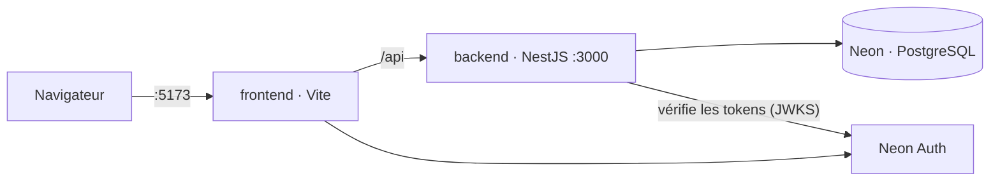
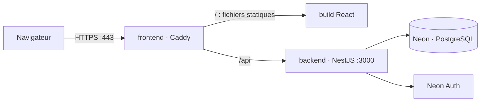
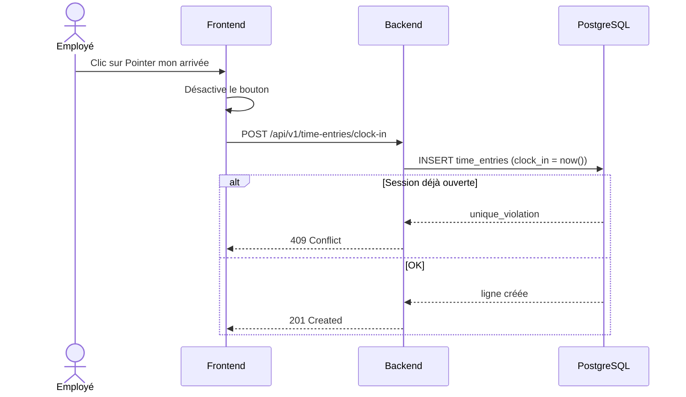

# Architecture

Monorepo avec deux applications indépendantes :

- `backend/` : API REST NestJS (port 3000). Toute la logique métier est ici.
- `frontend/` : application web React + Vite. Elle ne parle qu'à l'API.

La base PostgreSQL et l'authentification sont hébergées sur Neon. Le lancement est décrit dans le [README](../README.md).

## Développement

Le code est monté en volume dans les conteneurs : les modifications sont rechargées à chaud.

## Production

- L'image `frontend` (cible `prod`) contient Caddy. Il sert le build React et redirige `/api` vers le backend.
- Front et API partagent la même origine : pas de configuration CORS.
- Caddy active le HTTPS automatiquement quand `:80` est remplacé par le nom de domaine dans `frontend/Caddyfile`.

## Pointage d'arrivée

Flux le plus sensible : il ne doit jamais créer deux sessions ouvertes.

Le backend ne fait pas de lecture avant l'insertion : c'est l'index unique partiel de la base qui tranche, même si deux requêtes arrivent en même temps (voir [database.md](database.md)).

## Organisation du backend

Un module NestJS par domaine :

| Dossier | Contenu |
| --- | --- |
| `src/prisma/` | Contrat Prisma et client de base de données |
| `src/users/` | Utilisateurs, profil, suppression et anonymisation |
| `src/teams/` | Équipes et membres |
| `src/time-entries/` | Pointage et historique |
| `src/reports/` | Résumés, moyennes, KPI |
| `src/reports/calc/` | Calculs purs, sans base ([business-rules.md](business-rules.md)) |

La documentation des routes est générée par Swagger depuis le code.
