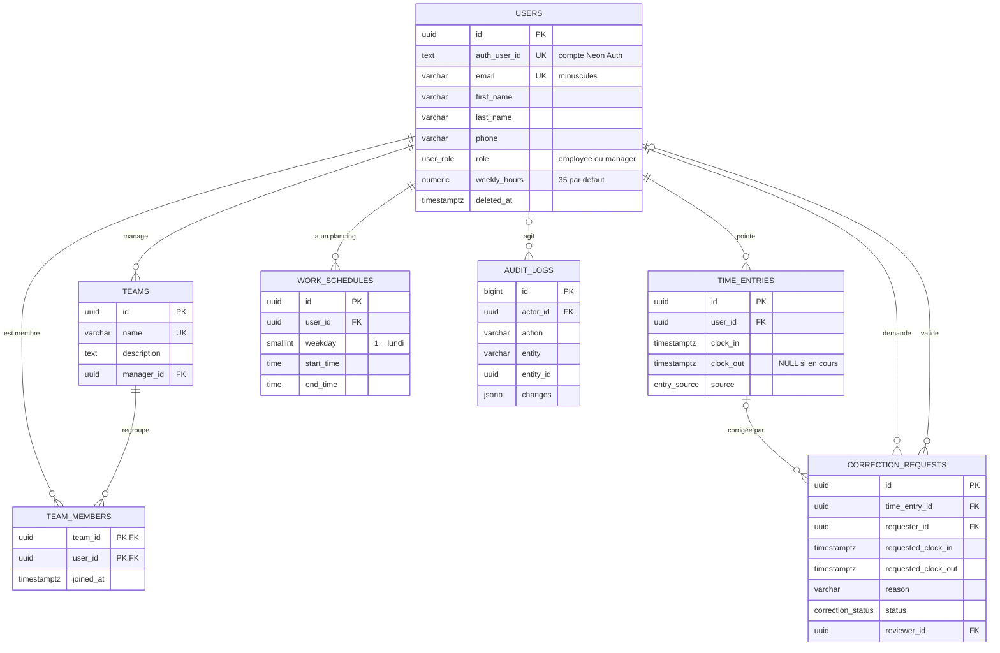

# Base de données

PostgreSQL hébergé sur Neon. Les comptes, mots de passe et sessions sont gérés par Neon Auth : ils n'apparaissent pas dans ce schéma. La table `users` porte le profil métier et le lien vers le compte Neon Auth.

## Modèle



## Relations

| Relation | Suppression | Raison |
| --- | --- | --- |
| `users` N–N `teams` via `team_members` | CASCADE sur la jointure | Un employé peut être dans plusieurs équipes |
| `teams.manager_id` → `users` | RESTRICT | On ne supprime pas un manager qui a encore une équipe |
| `time_entries.user_id` → `users` | RESTRICT | Les pointages sont conservés (obligation légale) |
| `work_schedules.user_id` → `users` | CASCADE | Un créneau par jour de semaine |
| `correction_requests.time_entry_id` → `time_entries` | CASCADE | NULL = journée entièrement oubliée |
| `audit_logs.actor_id` → `users` | SET NULL | L'historique survit à l'acteur |

Les utilisateurs ne sont jamais supprimés physiquement. Supprimer un compte renseigne `deleted_at` et anonymise les données personnelles (RGPD).

## Contraintes

Le service valide déjà ces règles. La base les garantit aussi, y compris quand deux requêtes arrivent en même temps.

```sql
CREATE EXTENSION IF NOT EXISTS btree_gist;

-- R-01 : une seule session ouverte par employé
CREATE UNIQUE INDEX one_open_entry_per_user
  ON time_entries (user_id) WHERE clock_out IS NULL;

-- R-08 : les sessions d'un employé ne se chevauchent pas
ALTER TABLE time_entries ADD CONSTRAINT time_entries_no_overlap
  EXCLUDE USING gist (user_id WITH =, tstzrange(clock_in, clock_out, '[)') WITH &&);

ALTER TABLE time_entries ADD CONSTRAINT time_entries_order
  CHECK (clock_out IS NULL OR clock_out > clock_in);

ALTER TABLE users ADD CONSTRAINT users_email_lower CHECK (email = lower(email));
ALTER TABLE users ADD CONSTRAINT users_weekly_hours CHECK (weekly_hours BETWEEN 0 AND 48);

ALTER TABLE work_schedules ADD CONSTRAINT schedules_one_per_day UNIQUE (user_id, weekday);

ALTER TABLE correction_requests ADD CONSTRAINT corrections_review
  CHECK ((status = 'pending') = (reviewer_id IS NULL));

CREATE INDEX time_entries_user_clock_in ON time_entries (user_id, clock_in DESC);
CREATE INDEX team_members_user ON team_members (user_id);
```

La base ne vérifie pas que `teams.manager_id` désigne un utilisateur de rôle `manager` : ce contrôle est fait dans le service teams.

## Connexion à Neon

| Variable | Usage |
| --- | --- |
| `DATABASE_URL` | URL poolée, utilisée par l'application |
| `DATABASE_URL_DIRECT` | URL directe, utilisée pour les migrations |

Les migrations ne passent pas par le pooler, d'où les deux URL.
